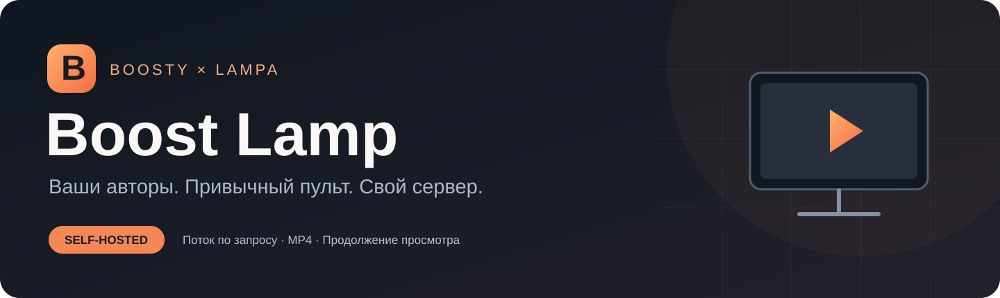
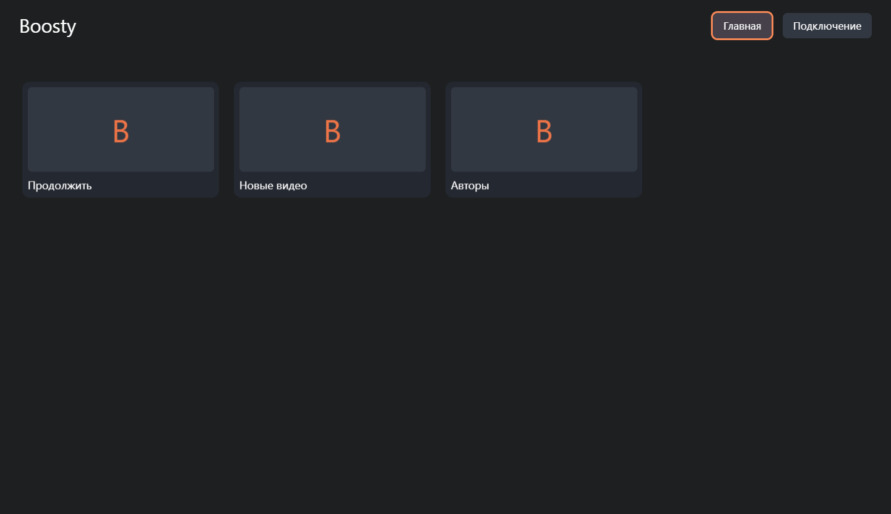
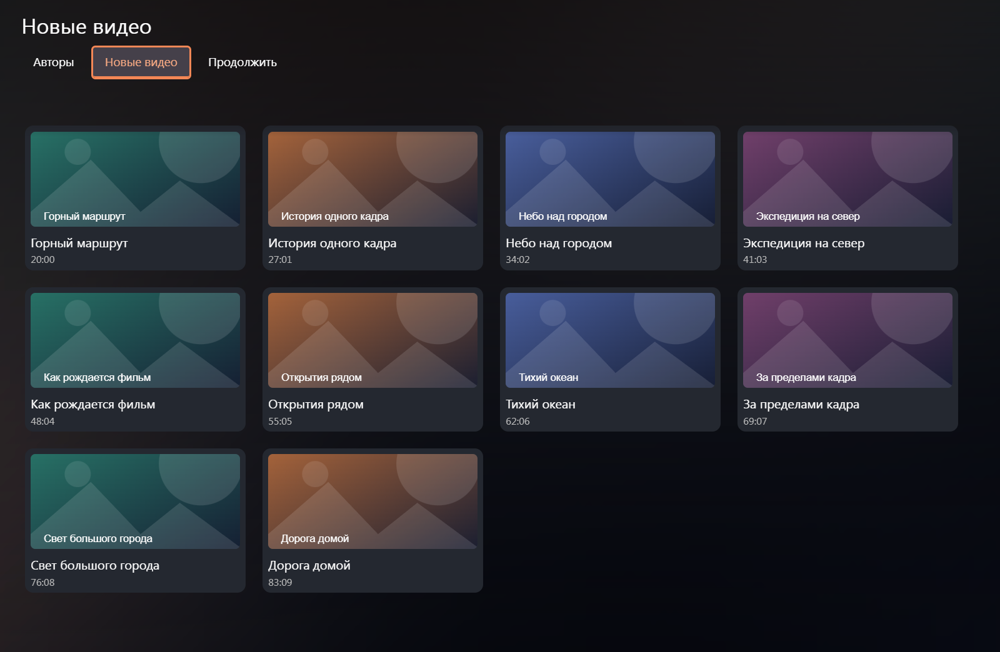
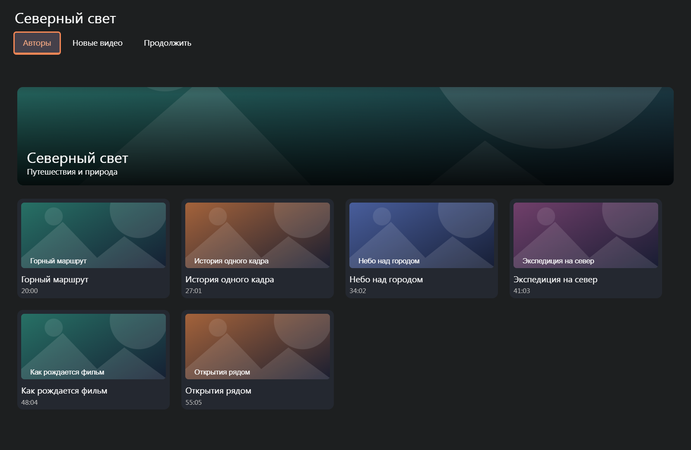
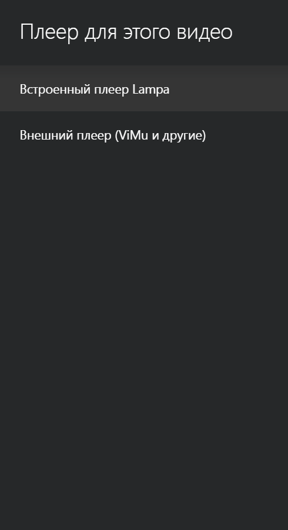
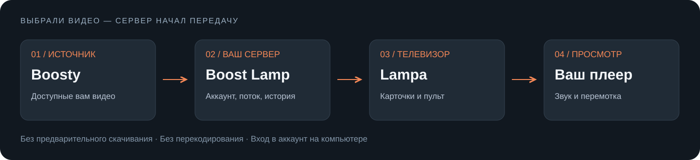

<p align="center">
  
</p>

<p align="center">
  <a href="https://github.com/q76325870-boop/boost-lamp/actions/workflows/tests.yml"></a>
</p>

<p align="center">
  <strong>Boost Lamp · Ваши авторы. Привычный пульт. Свой сервер.</strong><br>
  Неофициальный плагин для просмотра доступных вам видео Boosty в Lampa.
</p>

<p align="center">
  <a href="docs/INSTALL.md">Установка</a> ·
  <a href="docs/INSTALL.md#4-вход-в-boosty">Вход в аккаунт</a> ·
  <a href="docs/HANDOFF.md">Для агента</a> ·
  <a href="#как-это-устроено">Как устроено</a> ·
  <a href="SECURITY.md">Безопасность</a>
</p>

## Как это выглядит



*Интерфейс настоящей Lampa; на иллюстрациях вымышленные авторы и видео. В репозитории нет аккаунта, cookies и подписок владельца.*

| На телевизоре | На сервере |
| --- | --- |
| Авторы, новые видео, продолжение просмотра | Подключение одного аккаунта Boosty |
| Карточки и управление пультом | Проверка доступности видео при запуске |
| Выбор исходного качества | Передача MP4 по запросу, включая перемотку |
| Привычный плеер Lampa | Хранение позиции просмотра в SQLite |





Стрелки вверх и вниз переключают уровни: карточки → вкладки «Авторы / Новые видео / Продолжить» → верхняя панель Lampa. Между карточками и между вкладками используйте влево и вправо. После привязки кнопка «Подключение» скрывается.

Удерживайте **OK** на карточке видео, чтобы выбрать плеер для одного запуска, затем качество. На Android доступен внешний плеер — например, установленный ViMu. Обычное нажатие использует настройки Lampa; разовый выбор их не меняет. Действие доступно и в разделе «Продолжить».




## Как это устроено



Вы выбираете видео в Lampa. Сервер проверяет доступ вашего аккаунта и передаёт видеопоток телевизору. Фильм целиком не скачивается и не перекодируется. При кратком DNS-сбое сервер сам повторяет поиск адреса CDN: до трёх попыток с короткими паузами. Если источник по-прежнему недоступен, запрос завершается ошибкой, которую можно повторить. Подключение аккаунта выполняется на компьютере; телевизор получает отдельную привязку, а плеер — временный адрес потока.

Сервис устанавливается отдельным Docker Compose проектом. Уже работающие Lampa, TorrServer, VPN и плеер переустанавливать не нужно.

## Начать

1. Подготовьте Linux-сервер с Docker Compose и доступом из домашней сети.
2. Следуйте [пошаговой инструкции](docs/INSTALL.md): настройка адресов → запуск → вход через официальный сайт Boosty → привязка ТВ.
3. Добавьте в расширения Lampa адрес `http://SERVER_IP:19118/boosty.js`, заменив `SERVER_IP` адресом своего сервера.
4. Проверьте просмотр, звук, перемотку и продолжение на своём телевизоре.

Для передачи работы другому агенту приложите этот репозиторий или архив исходников вместе с [инструкцией агенту](docs/HANDOFF.md). Авторизацию другого владельца нужно выполнить заново.

## Границы первой версии

- Один аккаунт Boosty, несколько подключённых телевизоров. Новая привязка сохраняет прежние; на каждом устройстве свой активный просмотр. История общая: при просмотре одного ролика на нескольких ТВ сохраняется последняя полученная позиция. До четырёх одновременных HTTP-потоков; доступность зависит от сети и сервера.
- Видео Boosty типа `ok_video`, готовые MP4 и исходные варианты качества. HLS/DASH-only, прямые эфиры, аудиопосты, вложенные внешние плееры и офлайн-архив не поддерживаются.
- Сервис рассчитан на доверенную локальную сеть. Административный порт доступен только на самом сервере или через SSH-туннель. Публикация сервиса в интернете не входит в эту конфигурацию.
- Плагин не снимает ограничения подписки. Закрытые ролики доступны только при соответствующих правах аккаунта.
- Неофициальный API Boosty может измениться.
- Продолжение во внешнем плеере зависит от того, возвращает ли связка Lampa/Android/плеер позицию.

## Разработка

Python 3.13 в контейнере; JavaScript плагина совместим с синтаксисом ES5. Зависимости закреплены в `requirements.lock` и `requirements-dev.lock`. Runtime: один процесс, до 1 CPU и 512 МиБ RAM, без прав root; постоянные данные — отдельный Docker volume.

```sh
python -m venv .venv
# Linux/macOS:
. .venv/bin/activate
# Windows PowerShell: .\.venv\Scripts\Activate.ps1
python -m pip install -r requirements-dev.lock
python -m pytest -q
node --test --test-concurrency=1 tests/plugin.test.cjs
```

Запускайте проверки последовательно. Правила работы и защиты данных — в [AGENTS.md](AGENTS.md). Для обычной установки Node и тестовые зависимости на сервере не нужны.

## Вопросы и помощь

В issue укажите версию плагина, версию Lampa, модель/Android телевизора, плеер, действие и короткий код ошибки. Не прикладывайте cookies, файлы состояния, административный ключ, личные URL потоков и полный журнал браузера. Для сообщений об утечках используйте [порядок из SECURITY.md](SECURITY.md).

Проект не связан с Boosty, Lampa или производителями телевизоров. Благодарности: [Lampa](https://github.com/yumata/lampa-source), [FastAPI](https://github.com/fastapi/fastapi), [HTTPX](https://github.com/encode/httpx). Лицензия собственного кода — [MIT](LICENSE).
